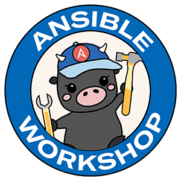

# Event-Driven Ansible Technical Workshop

Ansible Automation Platform can run a playbook when someone clicks Launch. Event-Driven Ansible is the part of the platform that starts that work when something in the environment changes: an alert fires, a webhook arrives, or a message shows up on a queue. A rulebook listens to a source, matches a condition, and runs an action, usually an Automation Execution job template or workflow.

This workshop walks that model on current Ansible Automation Platform. Event-Driven Ansible runs as Automation Decisions, in the same UI as Automation Execution. You configure a decision environment and a project, turn a rulebook into a rulebook activation that stays running, and use event streams when several activations should share one inbound webhook. A second lab runs `ansible-rulebook` directly, so the source, condition, and action are visible on their own.

The longer session that adds ServiceNow is the [4-hour workshop](eda-4).

**Key themes explored in the workshop:**

- **Sources, conditions, and actions**: A rulebook listens through an event source plugin, filters with a condition, and responds with an action. The rulebook lab does this with a webhook, a Kafka topic, and a URL check.
- **Automation Decisions**: Event-Driven Ansible calls Automation Execution through a credential in the unified Ansible Automation Platform UI. Decision environments carry the collections a rulebook needs, the same role execution environments play for playbooks.
- **Rulebook activations**: An activation pairs a project with a decision environment and keeps the rulebook listening. Rule Audit records each event that matches a condition.
- **From alert to action**: Prometheus and Alertmanager raise an event and the activation remediates it. Event streams collect inbound webhooks on the platform route and hand them to one or more activations, including a Gitea change that redeploys alerting rules.

## Workshop Resources

<table>
<thead>
<tr>
<th>Resource</th>
<th>Link</th>
</tr>
</thead>
<tbody>
<tr>
<td>Workshop content and exercises</td>
<td><a target="_blank" href="https://docs.google.com/presentation/d/18FsymQlk8cCBENHsh7NXyqvXtatfGOr8Nl761r1rU4w/edit?usp=sharing">🖥️ Google Slides</a></td>
</tr>
<tr>
<td>Post-event survey</td>
<td><a target="_blank" href="https://docs.google.com/document/d/1qUISl1h5u8H9_XlRhA0NkSo0ODeb9JB3u-tvek09Q9k/edit?usp=sharing">📋 Post-event survey</a></td>
</tr>
<tr>
<td>Registration page &amp; promotional email copy</td>
<td><a target="_blank" href="https://docs.google.com/document/d/1Ek2BnNxNQc_CRSmpwmfXM99dlHd7f1m6tPC7FC_kkhg/edit?usp=sharing">📝 Registration page &amp; promotional email copy</a></td>
</tr>
<tr>
<td>Event banners</td>
<td><a target="_blank" href="https://drive.google.com/drive/folders/12vUy6_tO_pVEN-hbGknDSWBWge4Z7L0V?usp=sharing">🎨 Event banners</a></td>
</tr>
</tbody>
</table>

## Target Audience

- Automation specialists and site reliability engineers
- Platform engineers who run Ansible Automation Platform
- Operations teams connecting observability tools to automation

## Attendee Prerequisites

* Experience building Ansible Playbooks and working with Ansible Automation Platform
* A basic understanding of Git and source control
* A laptop with Chrome, Firefox, Edge, or Safari. Both labs run in the browser on the Red Hat Demo Platform.

## Presentation Deck

- [Event-Driven Ansible 201](https://docs.google.com/presentation/d/18FsymQlk8cCBENHsh7NXyqvXtatfGOr8Nl761r1rU4w/edit?usp=sharing) - For Red Hat employees
- [Event-Driven Ansible 301](https://docs.google.com/presentation/d/1xQyUGRGqu-qpjZVRKrJvN3cbVLoFzZ0BP7ED1VOyuX4/edit?usp=sharing) - For Red Hat employees

## Lab Options

<table>
<thead>
<tr>
<th>Option</th>
<th>Link</th>
<th>Description</th>
</tr>
</thead>
<tbody>
<tr>
<td>Launch rulebook lab on RHDP</td>
<td><a target="_blank" href="https://catalog.demo.redhat.com/catalog/babylon-catalog-prod?item=babylon-catalog-prod/zt-ansiblebu.zt-ans-bu-eda-ansible-rulebook.prod&amp;utm_source=webapp&amp;utm_medium=share-link">🚀 Launch Lab</a></td>
<td>Provision <b>Get started with Event-Driven Ansible and Ansible Rulebooks</b></td>
</tr>
<tr>
<td>Launch Automation Decisions lab on RHDP</td>
<td><a target="_blank" href="https://catalog.demo.redhat.com/catalog/babylon-catalog-prod?item=babylon-catalog-prod/zt-ansiblebu.zt-ans-bu-eda-controller.prod&amp;utm_source=webapp&amp;utm_medium=share-link">🚀 Launch Lab</a></td>
<td>Provision <b>Event-Driven Ansible Controller Up and Running 2.5</b>. The showroom covers Automation Decisions, rulebook activations, and event streams.</td>
</tr>
</tbody>
</table>

## Lab provisioner

Both labs are on the [Red Hat Demo Platform](https://catalog.demo.redhat.com/catalog). The exercise guide opens in the showroom after the environment is provisioned.

They are also available as public labs. A free Red Hat account is required.

* [Get started with Event-Driven Ansible and Ansible Rulebooks](https://zero.rhdp.net/lab/zt-ansiblebu.zt-ans-bu-eda-ansible-rulebook.prod)
* [Event-Driven Ansible Controller Up and Running 2.5](https://zero.rhdp.net/lab/zt-ansiblebu.zt-ans-bu-eda-controller.prod)

## Exercises

<table>
<thead>
<tr>
<th>Activity</th>
<th>Link</th>
</tr>
</thead>
<tbody>
<tr>
<td><b>Slides</b>: Introduction + Workshop Brief</td>
<td><a target="_blank" href="https://docs.google.com/presentation/d/18FsymQlk8cCBENHsh7NXyqvXtatfGOr8Nl761r1rU4w/edit?usp=sharing">🖥️ Google Slides</a></td>
</tr>
<tr>
<td>Exercise 1 — Rulebook basics and a webhook source</td>
<td><a target="_blank" href="https://catalog.demo.redhat.com/catalog/babylon-catalog-prod?item=babylon-catalog-prod/zt-ansiblebu.zt-ans-bu-eda-ansible-rulebook.prod&amp;utm_source=webapp&amp;utm_medium=share-link">🚀 Launch Exercise</a></td>
</tr>
<tr>
<td>Exercise 2 — Kafka source</td>
<td><a target="_blank" href="https://catalog.demo.redhat.com/catalog/babylon-catalog-prod?item=babylon-catalog-prod/zt-ansiblebu.zt-ans-bu-eda-ansible-rulebook.prod&amp;utm_source=webapp&amp;utm_medium=share-link">🚀 Launch Exercise</a></td>
</tr>
<tr>
<td>Exercise 3 — URL check source</td>
<td><a target="_blank" href="https://catalog.demo.redhat.com/catalog/babylon-catalog-prod?item=babylon-catalog-prod/zt-ansiblebu.zt-ans-bu-eda-ansible-rulebook.prod&amp;utm_source=webapp&amp;utm_medium=share-link">🚀 Launch Exercise</a></td>
</tr>
<tr>
<td colspan="2"><b>Automation Decisions on Ansible Automation Platform</b></td>
</tr>
<tr>
<td>Exercise 4 — Introduction to Event-Driven Ansible</td>
<td><a target="_blank" href="https://catalog.demo.redhat.com/catalog/babylon-catalog-prod?item=babylon-catalog-prod/zt-ansiblebu.zt-ans-bu-eda-controller.prod&amp;utm_source=webapp&amp;utm_medium=share-link">🚀 Launch Exercise</a></td>
</tr>
<tr>
<td>Exercise 5 — Credentials, decision environments, and projects</td>
<td><a target="_blank" href="https://catalog.demo.redhat.com/catalog/babylon-catalog-prod?item=babylon-catalog-prod/zt-ansiblebu.zt-ans-bu-eda-controller.prod&amp;utm_source=webapp&amp;utm_medium=share-link">🚀 Launch Exercise</a></td>
</tr>
<tr>
<td>Exercise 6 — Rulebook activations</td>
<td><a target="_blank" href="https://catalog.demo.redhat.com/catalog/babylon-catalog-prod?item=babylon-catalog-prod/zt-ansiblebu.zt-ans-bu-eda-controller.prod&amp;utm_source=webapp&amp;utm_medium=share-link">🚀 Launch Exercise</a></td>
</tr>
<tr>
<td>Exercise 7 — Prometheus and Alertmanager</td>
<td><a target="_blank" href="https://catalog.demo.redhat.com/catalog/babylon-catalog-prod?item=babylon-catalog-prod/zt-ansiblebu.zt-ans-bu-eda-controller.prod&amp;utm_source=webapp&amp;utm_medium=share-link">🚀 Launch Exercise</a></td>
</tr>
<tr>
<td>Exercise 8 — Event streams</td>
<td><a target="_blank" href="https://catalog.demo.redhat.com/catalog/babylon-catalog-prod?item=babylon-catalog-prod/zt-ansiblebu.zt-ans-bu-eda-controller.prod&amp;utm_source=webapp&amp;utm_medium=share-link">🚀 Launch Exercise</a></td>
</tr>
</tbody>
</table>

# Ansible Workshop

This is an official Ansible Workshop

This workshop is maintained by the Red Hat Ansible Technical Marketing Team.
Please open an [issues on Github](https://github.com/ansible/workshops/issues/new?title=New+eda+workshop+issue&body=)

