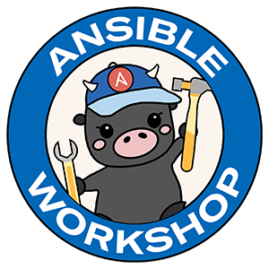

# Introduction to Automation Orchestrator

Automation orchestrator is an add-on to Red Hat Ansible Automation Platform: a composable canvas for designing and running complex IT operations workflows. In this 90-minute hands-on lab you will build workflows from scratch and modify existing workflows that will run against real systems.

For the uninitiated, a workflow is a sequence of connected steps. Each one starts with a trigger, and the steps you place after it determine the path the run takes.

Your existing automation plugs directly into these workflows, giving you reusable, tested, and validated steps built on an execution layer you already trust.

Within this lab, you will come across six modules that will allow you to build and complete four different workflows.

* A **message of the day** workflow on an empty canvas: a trigger, a task agent, and an AAP job template that writes the agent's wording into the login banner on a real RHEL host
* A **disk utilization** workflow that branches on how full a filesystem is and hands the fix to AAP
* A **ticket enrichment** workflow where a task agent reads a live ITSM incident and routes it to auto-remediation, an approval gate, or back for human approval
* A **CVE auto-remediation** workflow that patches development hosts automatically while requiring approval before production environments, routing on findings from Red Hat Lightspeed

**Red Hat products included:** Ansible Automation Platform, OpenShift Container Platform, Red Hat Enterprise Linux, and Red Hat Lightspeed. Supporting applications in the environment: OpenFlake (the ITSM system holding the incident tickets), Gitea (the Git service the CVE remediation playbook is committed to), and Mattermost (where your workflows post notifications).

## Workshop Resources

<table>
<thead>
<tr>
<th>Resource</th>
<th>Link</th>
</tr>
</thead>
<tbody>
<tr>
<td>Workshop content and exercises</td>
<td><a target="_blank" href="https://rhpds.github.io/intro-ao-workshop/modules/index.html">rhpds.github.io/intro-ao-workshop</a></td>
</tr>
<tr>
<td>Follow-up assets</td>
<td><a target="_blank" href="http://red.ht/ansible_trial">Start your free trial (red.ht/ansible_trial)</a> · <a target="_blank" href="https://www.redhat.com/en/technologies/management/ansible/automation-orchestrator">Learn more about automation orchestrator</a></td>
</tr>
</tbody>
</table>

## Target audience

You will get the most out of this lab if you are:

* An automation engineer or platform team member interested in using automation orchestrator alongside your existing Ansible Automation Platform environment
* Working with alerts, tickets, or logs that require someone to interpret the information before deciding which automation to run
* Curious about how AI-powered task agents can recommend actions while keeping humans in the loop when approvals are needed
* Evaluating automation orchestrator and would rather build and run real workflows than watch a demo

## Attendee Prerequisites

* Familiarity with the basics of Ansible Playbooks and AAP job templates
* No prior automation orchestrator experience required
* No playbook writing required, you will not write a single one to complete the modules
* Everything runs in the browser, there is nothing to install

## Presentation Deck

- <a target="_blank" href="https://docs.google.com/presentation/d/1KM5ccHj8--u6PnLsKwkWVtzvRIBqSt7L1ppk0bplUgs/edit?usp=sharing">Google Slides</a> - For Red Hat employees (Introduction to Automation Orchestrator)

## Lab provisioner

* Lab documentation: <a target="_blank" href="https://rhpds.github.io/intro-ao-workshop/">https://rhpds.github.io/intro-ao-workshop/</a>
* Demo Platform (RHDP) <a target="_blank" href="https://catalog.demo.redhat.com/catalog/babylon-catalog-prod?item=babylon-catalog-prod/published.intro-ao-workshop.prod&utm_source=webapp&utm_medium=share-link">direct link</a>

**List of Proctors:** TBD

If you are an SA, SSP, or TMM you will have no problem proctoring this lab. If you have any questions around proctoring this lab, reach out to the Ansible TMM team.

## Lab Index (Estimate total time ⏱️ 90 minutes)

Complete the modules in order. Each one builds on the integrations and concepts from the last. Add roughly 15 minutes if you are presenting the introduction and summary slides alongside the lab.

<table>
<thead>
<tr>
<th>Activity</th>
<th>Link</th>
<th>Estimated Time</th>
</tr>
</thead>
<tbody>
<tr>
<td>Module 1: Lab overview</td>
<td><a target="_blank" href="https://rhpds.github.io/intro-ao-workshop/modules/index.html">🚀 Launch Exercise</a></td>
<td>⏱️ 5 minutes</td>
</tr>
<tr>
<td>Module 2: Getting started, integrations and credentials</td>
<td><a target="_blank" href="https://rhpds.github.io/intro-ao-workshop/modules/module-02-integrations-and-credentials.html">🚀 Launch Exercise</a></td>
<td>⏱️ 15 minutes</td>
</tr>
<tr>
<td>Module 3: Your first workflow, message of the day</td>
<td><a target="_blank" href="https://rhpds.github.io/intro-ao-workshop/modules/module-03-your-first-workflow-motd.html">🚀 Launch Exercise</a></td>
<td>⏱️ 15 minutes</td>
</tr>
<tr>
<td>Module 4: Disk utilization remediation</td>
<td><a target="_blank" href="https://rhpds.github.io/intro-ao-workshop/modules/module-04-disk-utilization.html">🚀 Launch Exercise</a></td>
<td>⏱️ 15 minutes</td>
</tr>
<tr>
<td>Module 5: Ticket enrichment workflow</td>
<td><a target="_blank" href="https://rhpds.github.io/intro-ao-workshop/modules/module-05-ticket-enrichment.html">🚀 Launch Exercise</a></td>
<td>⏱️ 20 minutes</td>
</tr>
<tr>
<td>Module 6: CVE auto-remediation workflow</td>
<td><a target="_blank" href="https://rhpds.github.io/intro-ao-workshop/modules/module-06-cve-remediation.html">🚀 Launch Exercise</a></td>
<td>⏱️ 20 minutes</td>
</tr>
<tr>
<td><b>Slides</b>: Introduction &amp; Summary (optional)</td>
<td><a target="_blank" href="https://docs.google.com/presentation/d/1KM5ccHj8--u6PnLsKwkWVtzvRIBqSt7L1ppk0bplUgs/edit?usp=sharing">🖥️ Google Slides</a></td>
<td>⏱️ 15 minutes</td>
</tr>
</tbody>
</table>

# Learning Resources

- <a target="_blank" href="https://github.com/rhpds/intro-ao-workshop">Workshop exercises (GitHub)</a>
- <a target="_blank" href="https://docs.google.com/presentation/d/16pkh6Js89q7gR5VUILEQEU0mYRi6Ti98c9aRTcPOBVs/edit?usp=sharing">Red Hat Ansible Automation Platform - Training + Certification slides</a>
- YouTube playlist: <a target="_blank" href="https://www.youtube.com/watch?v=okNsfsaRa8E&amp;list=PLCb37rY-Ibs0">Intro to Automation Orchestrator Lab</a>

# Ansible Workshop

This is an official Ansible Workshop

This workshop is maintained by the Red Hat Ansible Technical Marketing Team.  
Please open an <a target="_blank" href="https://github.com/ansible/workshops/issues/new?title=New+intro+ao+lab+workshop+issue&body=">issues on Github</a>

